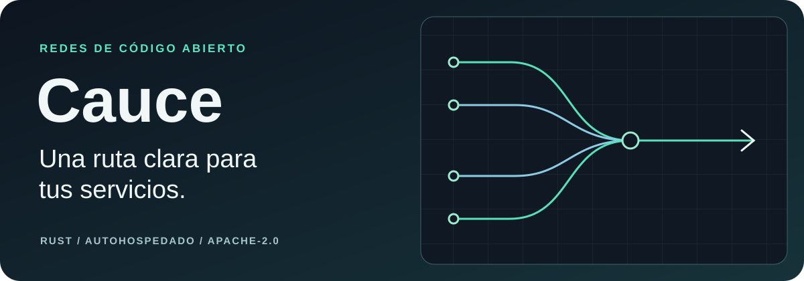

[English](README.md) · **Español** · [Ficha del producto (PDF)](docs/CAUCE-brief.pdf)

Cauce es un proxy inverso con licencia Apache-2.0 para equipos que quieren un punto de entrada para sus API HTTP y conexiones de larga duración. Instálalo en tu infraestructura, define rutas en YAML versionado y observa cómo circula el tráfico entre tus servicios.

## Qué puedes hacer

| Necesidad | Capacidades del checkpoint de desarrollo |
| --- | --- |
| Dar una entrada común a varios servicios | Enrutamiento por host exacto y por prefijo de ruta más largo, balanceo round-robin o por menor número de solicitudes en curso y conexiones reutilizables por TCP o sockets Unix. |
| Servir más que peticiones HTTP cortas | HTTP/1.1, HTTP/2, gRPC, WebSocket y Server-Sent Events. Los cuerpos pueden transmitirse sin almacenar toda la respuesta en memoria. |
| Cambiar rutas sin reinicios innecesarios | Valida YAML o TOML sin iniciar el servicio. Recarga cambios compatibles y material TLS de forma atómica; si la configuración no es válida, sigue operando la anterior. |
| Operarlo en tu infraestructura | HTTPS de entrada, TLS configurable hacia los servicios con verificación de certificado y nombre, cierre gradual, métricas Prometheus y logs JSONL con recolector opcional. |

## Pruébalo en local

Con Docker y Docker Compose:

```sh
git clone https://github.com/bahamondeX/cauce.git
cd cauce
docker compose up --build -d
curl -fsS http://127.0.0.1:8080/
curl -NsS --max-time 5 http://127.0.0.1:8080/sse
docker compose down
```

> **Seguridad del recolector:** Usa el perfil predeterminado de Compose para esta prueba. El recolector opcional del checkpoint de desarrollo enlaza SQLite 3.54.1; consulta la [evidencia de remediación](docs/SQLITE-SECURITY.md).

El ejemplo expone el proxy solo en la interfaz de loopback e incluye servicios de prueba. La prueba SSE tiene un límite de cinco segundos para no dejar abierta la terminal. Para compilar de forma nativa con Rust 1.89 o posterior:

```sh
cargo build --release --locked
cargo run --locked -- check examples/cauce.yaml
cargo test --locked
```

## Evidencia y límites

El checkpoint de desarrollo actual incluye HTTP/1.1, HTTP/2, HTTP/3 de entrada, gRPC, WebSocket, SSE, archivos estáticos, caché en memoria y disco, compresión, TCP/UDP, TLS passthrough, Stream TLS, mTLS, ACME HTTP-01, FastCGI, uWSGI, SCGI y proxy de correo. Consulta [STATUS.md](STATUS.md) y el [informe del Milestone 11](docs/PERFORMANCE-MILESTONE-11.md) para conocer las pruebas y limitaciones.

Cauce 1.0 aún no está calificado. La paridad completa de comportamiento con NGINX, el rendimiento competitivo nativo actual y el escalamiento multinúcleo siguen pendientes. La ficha del producto describe un checkpoint anterior.

[Configuración](docs/CONFIGURATION.md) · [Arquitectura](docs/ARCHITECTURE.md) · [HTTP/2 y gRPC](docs/HTTP2.md) · [Observabilidad](docs/LOGGING.md) · [Licencia](LICENSE)

Una [prueba histórica en AMD64](docs/CAUCE-benchmark-note.md) documenta el compromiso entre CPU y latencia en una compilación no publicada.
