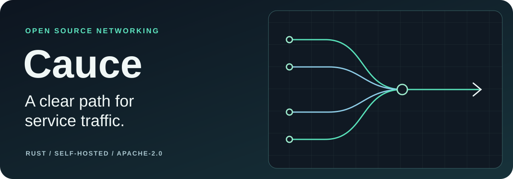

**English** · [Español](README.es.md) · [Product brief (PDF)](docs/CAUCE-brief.pdf)

Cauce is an Apache-2.0 reverse proxy for teams that want one front door for HTTP APIs and long-lived streams. Run it on your infrastructure, describe routes in versioned YAML, and see how traffic moves through your services.

## What you can do

| Need | Capabilities of the current development checkpoint |
| --- | --- |
| Put one entry point in front of several services | Exact host and longest path-prefix routing, round-robin or least-inflight balancing, and pooled upstream connections over TCP or Unix sockets. |
| Serve more than short HTTP requests | HTTP/1.1, HTTP/2, gRPC, WebSocket upgrades, and Server-Sent Events. Bodies can stream without buffering the whole response. |
| Change routes without an avoidable restart | Check YAML or legacy TOML offline. Reload compatible configuration and TLS material atomically; an invalid candidate leaves the current configuration running. |
| Operate it yourself | Inbound HTTPS, configurable upstream TLS with certificate and hostname verification, graceful draining, Prometheus metrics, and optional structured JSONL access logs and collector. |

## Try it locally

With Docker and Docker Compose:

```sh
git clone https://github.com/bahamondeX/cauce.git
cd cauce
docker compose up --build -d
curl -fsS http://127.0.0.1:8080/
curl -NsS --max-time 5 http://127.0.0.1:8080/sse
docker compose down
```

> **Collector safety:** Use the default Compose profile for this quickstart. The optional collector now links SQLite 3.54.1 in the development checkpoint; see [remediation evidence](docs/SQLITE-SECURITY.md).

The example exposes the proxy on loopback and includes sample backends. The SSE example uses a five-second limit so it does not hold the terminal open. For a native build with Rust 1.89 or newer:

```sh
cargo build --release --locked
cargo run --locked -- check examples/cauce.yaml
cargo test --locked
```

## Evidence and boundaries

The current development checkpoint supports HTTP/1.1, HTTP/2, downstream HTTP/3, gRPC, WebSocket, SSE, static files, memory and disk caching, compression, TCP/UDP, TLS passthrough, Stream TLS, mTLS, ACME HTTP-01, FastCGI, uWSGI, SCGI and mail proxying. See [STATUS.md](STATUS.md) and the [Milestone 11 report](docs/PERFORMANCE-MILESTONE-11.md) for tested scope and limitations.

Cauce 1.0 remains unqualified. Complete NGINX behavioral parity, current native competitive performance and multicore scaling remain open. The product brief describes an earlier checkpoint.

[Configuration](docs/CONFIGURATION.md) · [Architecture](docs/ARCHITECTURE.md) · [HTTP/2 and gRPC](docs/HTTP2.md) · [Observability](docs/LOGGING.md) · [License](LICENSE)

A separate [historical AMD64 benchmark](docs/CAUCE-benchmark-note.md) documents a CPU/latency tradeoff for an unreleased build, not the public release.
