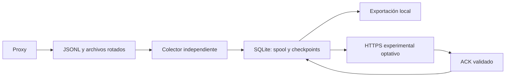

# Colector opcional — Cauce 0.9.1

`cauce-collector` es un binario Rust separado del proxy. Lee sus JSONL y guarda
lotes en un spool local. El proxy no llama al colector, no espera sus ACK y sigue
sirviendo tráfico si el colector está detenido, falla o llena su cuota.

Por defecto el colector funciona offline. El [contrato local revisado de
Connectivity](CONNECTIVITY.md) ya incluye un adaptador compatible con **proposal-1**,
autenticación de máquina y namespace autorizado por el servidor. No se acredita
un endpoint desplegado. Las pruebas de Cauce contra fixtures acreditan el cliente;
las pruebas del adaptador real declaradas por el equipo servidor se distinguen
de las ejecutadas aquí.



## Arranque offline

```sh
cargo build --release --locked
./target/release/cauce-collector --config examples/collector.toml
# Tras detener el proceso, inspeccionar o exportar sin consumir la cola:
./target/release/cauce-collector --config examples/collector.toml --status
./target/release/cauce-collector --config examples/collector.toml --export stdout
```

El ejemplo usa las rutas de Docker; para ejecución nativa adapte `access_log` y
`state_path` a directorios que pueda leer/escribir. `--once` procesa como máximo
un lote nuevo y un intento de envío, si está habilitado. Permite ejecutar el
colector bajo otro supervisor. Sin `--once` hace polling y reintenta con backoff.

```sh
# Colector independiente, sin red y deshabilitado en el arranque normal:
docker compose -p cauce-local --profile collector up --build -d
# Detener antes de inspeccionar: un solo dueño del estado.
docker compose -p cauce-local stop collector
docker compose -p cauce-local --profile collector run --rm --no-deps collector \
  --config /etc/cauce/collector.toml --status
docker compose -p cauce-local --profile collector run --rm --no-deps collector \
  --config /etc/cauce/collector.toml --export stdout
```

Compose monta logs de solo lectura, un volumen `collector-state` separado de
lectura/escritura y `network_mode: none`. El usuario es UID/GID 10001, sin
capabilities ni root filesystem escribible. Los logs de operación del contenedor
se rotan con un máximo de tres archivos de 1 MiB. La exportación es JSONL de envelopes;
conserva el spool y no equivale a un ACK. `--export PATH` exige que el archivo no
exista, para evitar sobrescribir estado, credenciales o logs. El modo offline
conserva todos los lotes hasta alcanzar la cuota; exportarlos no libera espacio. Detener el colector no borra datos. No
use `docker compose down -v` si desea conservar logs y checkpoints.

## Persistencia y límites

SQLite usa `journal_mode=DELETE`, `synchronous=EXTRA` y páginas de 4096 bytes; en macOS activa `fullfsync`.
SQLite guarda cada lote y el nuevo offset del archivo en **la misma transacción**.
El checkpoint de lectura significa “persistido en el spool”, no “aceptado por el
servidor”. Si se interrumpe la transacción, se recupera su estado anterior. Una vez
aceptado y validado un ACK, otra transacción retira el lote de la cola. No se
vuelve a leer lo que permanece en el spool después de un reinicio. Una caída tras
el ACK pero antes de retirar el lote de forma durable puede provocar otro envío.

Esta separación permite absorber una caída del destino hasta la cuota local. Al
agotarla se pausa la lectura; no se borran lotes antiguos para hacer sitio. Los
logs del proxy siguen rotando de manera independiente: su retención debe cubrir
el retraso máximo previsto. Una cuota finita no garantiza conservar todo durante
una caída ilimitada.

Los límites configurables incluyen bytes de spool, tamaño máximo de base de
datos, eventos/bytes por lote, bytes por línea, archivos seguidos, intervalo de
poll y deadline/backoff de envío. SQLite limita las páginas de la base a
`floor(db_max_bytes / 4096)`; por eso el máximo efectivo de la base puede ser
menor que el valor configurado. Usa un journal de rollback, sin WAL de
crecimiento indefinido. El límite de páginas de la base, el espacio temporal
del journal y los bytes de payload en cola son cantidades distintas. Proteja el
volumen y reserve espacio para ambos; consulte los valores en
`examples/collector.toml`. No se ejecuta `VACUUM` automáticamente.

Se leen solamente líneas terminadas en newline. Un fragmento al final espera
hasta completarse. Una línea inválida o mayor que el límite detiene el avance en
ese archivo y el proceso termina con error; no se la omite silenciosamente. El operador debe
corregir o archivar el origen con un procedimiento explícito si desea avanzar.
No hay una cola de errores ilimitada ni captura de tokens/cuerpos HTTP.

La rotación admitida es la del proxy: `access.jsonl`, `access.jsonl.1`, `.2`, etc.
Se recorren como máximo `max_files` generaciones rotadas más el archivo activo,
desde la más antigua, y los checkpoints
usan identidad del archivo y offset para evitar repetir el mismo inode al
renombrarlo. La detección de reescrituras compara identidad de dispositivo/inode,
tamaño y marcas de modificación; además conserva muestras de hasta 256 bytes del
inicio y 256 del extremo confirmado. Son comprobaciones heurísticas, no un hash
de todo el archivo, y no garantizan detectar una reescritura que preserve esos
indicios. Cuando una generación pendiente o el archivo activo no aparece en el
descubrimiento, el colector exige dos observaciones ausentes separadas por al
menos 50 ms antes de detenerse con error; no escribe un registro de gap ni omite
automáticamente el contenido pendiente. Una ventana breve de rename se difiere
al siguiente sondeo. Si el inode permanece fuera del descubrimiento durante ese
plazo, el proceso se detiene para evitar perder datos. Inspeccione los archivos
rotados antes de reiniciar después de ese error. No se promete detectar archivos
completos que se crearon y eliminaron entre observaciones. `copytruncate` tiene
ventanas de pérdida intrínsecas; no se recomienda para estos logs. En la prueba
Docker, las operaciones de rename se ejecutan desde un contenedor sobre el
volumen compartido para conservar la identidad POSIX de la VM. Los casos probados
se describen en la validación de almacenamiento de este incremento.

La base de datos queda asociada al path del origen y, tras habilitar envío, al
endpoint configurado. Cambiarlos al reutilizar el estado se rechaza. Para una
migración explícita, detenga el colector, exporte y conserve la base anterior;
configure un estado separado y acuerde cómo tratar duplicados con el receptor.
La rotación de credenciales del mismo destino sí está permitida y debe conservar
la misma identidad autorizada. Cambiar el token a otra organización o namespace no es una
rotación segura: el ACK de este contrato no expone identidad y el colector no
puede verificar a qué namespace pertenece la credencial nueva. El operador y
el aprovisionamiento servidor deben preservar esa vinculación.

Un único proceso puede abrir el estado. Mantenga la base de datos, su journal y
el lock en el mismo volumen persistente. No comparta el estado entre nodos,
réplicas o sistemas de archivos de red sin verificar sus garantías de locking y
fsync. El spool contiene los eventos completos: controle permisos, copias de
seguridad y retención del volumen.

## Envío experimental HTTPS

Requiere cambiar explícitamente `delivery` a `proposal-http` y configurar un
endpoint HTTPS, `token_file` y el material CA pertinente. No hay endpoint ni
credencial de Connectivity por defecto. Para Docker también necesita habilitar
una red y montar la credencial/CA de solo lectura. No envíe registros a la API
pública de lecturas de Connectivity.

Cada petición envía un envelope estable:

```json
{"contract_version":"proposal-1","batch_id":"<uuid>","events":["<eventos del esquema access-log 1.0 o 1.1>"]}
```

El array del ejemplo representa objetos de eventos, no strings en el protocolo.
Un [export completo validado](increment3-compose-export.jsonl) y los esquemas
`collector-batch.schema.json` / `access-log.schema.json` permiten revisar el formato
exacto. `scripts/validate-collector.py` valida envelopes y eventos conjuntamente.
El servidor responde con HTTP **200** y exactamente el ID y la cantidad completa aceptada:

```json
{"batch_id":"<mismo uuid>","accepted_count":128}
```

Solo se elimina un lote después de comprobar estado HTTP y ACK. Desde 0.9.1 se
rechazan otros códigos 2xx aunque su cuerpo parezca válido; los errores de parseo
del ACK no imprimen claves ni valores del receptor. Respuestas de autenticación,
rate limiting, fallos del servidor, ACK incorrecto, timeout o cierre antes del ACK
conservan el lote. No hay aceptación parcial. Las redirecciones no se siguen.
TLS verifica cadena y hostname; no existe una opción para desactivar validación.
El endpoint rechaza userinfo, query y fragmentos. No se usan proxies definidos
mediante variables de entorno. La credencial se vuelve a leer para cada intento, lo que permite rotación del
archivo sin copiarla al spool. Credencial y CA deben ser archivos regulares,
no enlaces simbólicos. Si se proporciona `ca_file`, sus certificados se añaden a
las raíces públicas incluidas por el transporte; no se carga el almacén del SO. El deadline también acota la lectura del ACK, limitada a 4096 bytes.

`SIGTERM`/`SIGINT` cancelan el envío pendiente y cierran el proceso conservando
el lote no confirmado. Las transacciones SQLite son síncronas y no se interrumpen
a mitad de una llamada. El runtime limita a cuatro los hilos de resolución
bloqueante y espera hasta 500 ms por ellos al cerrar; un bloqueo del sistema de
archivos no está sujeto a un deadline asíncrono.

`batch_id` y los `event_id` se conservan en los reintentos. El receptor puede haber
persistido el lote aunque su ACK no llegue: el envío es **al menos una vez bajo
las condiciones de persistencia y retención descritas**, y puede duplicar. Un
servidor real debe deduplicar por identidad autenticada + `event_id` y responder
idempotentemente. No deduplicar por tiempo ni por contenido: solicitudes
legítimas pueden tener campos iguales.

No se aceptan campos de log como autoridad de tenant. El adaptador local de
Connectivity autentica la credencial y autoriza el namespace en el servidor,
según sus documentos. El colector no implementa login interactivo, emisión de
JWT, autorización cross-org ni un servidor de Connectivity. Para ese adaptador
use la ruta `/v1/ingest/cauce-proposal`, máximo 128 eventos y 524288 bytes por
lote; [collector-connectivity.toml](../examples/collector-connectivity.toml)
conserva el modo offline hasta habilitar explícitamente el transporte.
La ruta NDJSON con aceptación parcial no es compatible. Consulte
[CONNECTIVITY.md](CONNECTIVITY.md) para límites temporales, mapping, rate limits,
evidencia local del servidor y montaje aún pendiente de esta ejecución.

## Pruebas reproducibles

El incremento 9 añade [fallos reales en Docker](VALIDATION-9.md): spool saturado,
filesystem `ENOSPC` y `SIGKILL` del proceso. Ante `ENOSPC` el proceso puede terminar
con error: libere espacio y reinícielo sobre el mismo estado y logs; la prueba
verifica que una transacción fallida no adelanta el checkpoint. Configure un
supervisor con backoff para el despliegue; el laboratorio reinicia explícitamente.
En modo `spool`, exportar no libera cuota. Para reanudar un spool lleno sin
eliminar datos, la prueba amplía `spool_max_bytes`/`db_max_bytes` y reinicia.
La retención del origen debe alcanzar a los datos aún no leídos. No elimine
la base de datos para resolver una saturación. La prueba de `SIGKILL` conserva
el montaje: no equivale a pérdida eléctrica ni a recuperar un tmpfs eliminado.

```sh
python3 scripts/test-resilience-docker.py --image cauce:0.9-final-arm64
cargo test --locked
python3 scripts/test-collector.py
python3 scripts/test-collector-storage.py
# Usa colima start automáticamente si Docker no responde.
docker build -t cauce-collector:test .
python3 scripts/test-collector.py --docker --image cauce-collector:test
python3 scripts/test-collector-storage.py --docker --image cauce-collector:test
python3 scripts/test-collector-compose.py
uv run --no-project --with jsonschema python scripts/validate-collector.py \
  docs/increment3-compose-export.jsonl
```

Las pruebas generan una CA y credenciales sintéticas bajo `work/`, no incluidas en
la distribución. El fixture `tests/collector/sink.py` es un receptor de prueba
para proposal-1. No se despliega ni se usa como API de producción. La evidencia,
resultados ejecutados y límites están en [VALIDATION-3.md](VALIDATION-3.md).
